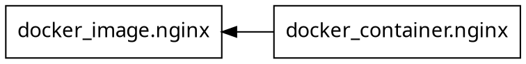

# notes

- 学習メモを置く場所。最終的にはトピックごとに 1 ファイル（例: `state.md`、`modules.md`）で書いていく。
- 最初は未整理状態で良いので、ここに雑なメモの形で記述する

## terraform コマンドを実行するカレントディレクトリ

- カレントディレクトリ = 1つの独立した Terraform プロジェクト、正式には、このディレクトリをルートモジュールと呼ぶ
- カレントディレクトリで決まるもの
  - 読み込む .tf ファイル
    - カレントディレクトリ直下の *.tf すべて（サブディレクトリは読まない）
    - サブディレクトリのコードを使いたいときは、module ブロックで明示的に呼び出す
  - state ファイルは、例えば、ローカル backend の場合は、 ./terraform.tfstate へ読み書きする。S3 などに配置されることもある。
  - プロバイダ置き場は、 ./.terraform/ 、 init で作られる
  - ロックファイルは、 ./.terraform.lock.hcl
  - 自動で読み込む変数ファイルは、 ./terraform.tfvars、./*.auto.tfvars
  - 相対パスの基準
    - `-var-file=dev.tfvars` などは、カレントディレクトリから探す
- cd せずに実行する: -chdir
  - 指定したディレクトリに cd したのと同じ扱いになる
  - 例: `terraform -chdir=exercises/01-local-basics plan`

## .tf やコードに読み込み順序はない

- 要点: 順序が意味を持たない2つのレベル
  - ファイル間の順序に意味はない
    - ディレクトリ内の *.tf は、すべて合体して1つの設定として扱われる
  - ファイル内のブロックの順序にも意味はない
    - 後ろに書いたものや、別のファイルに書いたものも、そのまま参照できる
- 思想
  - Terraform は宣言型の言語。 「上から順に実行する手順書」ではなく、「最終的にあるべき姿」の記述で決まる。
  - 実行順は、コード中の参照関係（と depends_on）から作られる依存グラフで決まる
- 補足
  - 同じアドレスを2回定義するとエラーになる
  - 例外として override.tf と *_override.tf がある
    - これらは通常のファイルの後に適用されて、定義を上書きする。順序に意味がある、数少ない特殊なファイル。

## HCL と Terraform の役割の違い

- 役割の違い
  - HCL = 構文とパーサー、ブロックの順序の解析と保持はこれが行う
  - Terraform = 「全 .tf を合体」「トップレベルの順序を無視」「依存グラフで実行順を決める」などを決めている
    - 例外として、provisioner やリスト型のネストブロックは書いた順序に意味がある
- HCL を使った他ツールも存在する
  - Packer や Nomad など

## 用語

- configuration file
  - = .tf
  - Ref) https://developer.hashicorp.com/terraform/language/files#file-extension
    - > Files containing Terraform code are often called configuration files.
- HashiCorp Configuration Language
  - = HCL
- module（モジュール）
  - 1つのディレクトリにある .tf ファイルのまとまり
- root module（ルートモジュール）
  - terraform コマンドを実行するディレクトリのモジュール
- Terraform language
  - .tf を書く言語、HCL の構文をベースにしている

## Terraform が状態を把握する仕組み: コード・state・実物

### Terraform は、 3 つのものを照らし合わせて状態を把握する

- 3つの登場人物
  - コード（.tf）
    - あるべき姿、「こうあってほしい」という宣言
    - 例: random_pet を length = 2 で
  - state（terraform.tfstate）
    - 「自分はこれを作って管理している」という Terraform の記憶
    - 例: random_pet.name = accepted-narwhal、local_file.hello = ID 2286ae...
  - 実物
    - 実際に存在しているもの
    - ディスク上の hello.txt
- state の役割
  - 最も重要な役割は、コード上のアドレス（local_file.hello）と実物（ID 2286ae... のファイル）を結び付けること
  - Terraform は、この対応表を通してしか実物を認識できない
    - state にない実物を管理下に入れるには、terraform import を使う

### plan の 2 段階の振る舞い

- A) refresh
  - state と実物の比較を行う。state に記録されたリソースを、プロバイダが1つずつ確認しに行く。
    - 出力の "Refreshing state..." の行
    - state に載っているものだけが対象、state にない実物は確認すらされない
      - なお、resource の場合の挙動。data ソースの場合は別。
  - 実物が変わっていたら、Terraform の state の認識をメモリ内で更新する
    - この作用だけを記録したいなら `terraform apply -refresh-only`
- B) diff
  - コードと refresh で更新後の state の比較を行う
  - 差分を、作成 / 更新 / 作り直し / 削除 のアクションにする

### Core とプロバイダの役割

- Core（terraform コマンド本体） <-> プロバイダ <-> 実物、の間で接触する
- Core の仕事: state の管理、依存グラフの作成、差分計算、実行順の制御
- プロバイダ の仕事: 実物との通信。ファイルを読む、Docker API を呼ぶ、AWS API を呼ぶ、など
  - リソースごとに Create / Read / Update / Delete を実装している
  - 外部に実体を持たないリソース（random_pet など）の場合は、state の値のみを参照して結果を返す

### よくあるパターンの例

- コード = state = 実物
  - No changes. が表示される
- コード ≠ state
  - コードに追加したら \+、コードから消したら \-、その場で変更できる属性なら ~、変更できない属性（forces replacement）なら \-/\+
  - 例: 変数を更新した状況など
- state ≠ 実物
  - どうなるかは、プロバイダの Read の実装次第
    - 多くのリソースでは、ドリフトがあると ~（変わった属性を戻す更新）になる。実物が削除されていた場合は \+ create になる。
- state が空
  - 全部 \+ create、refresh なし
  - state が空だと、実物があっても見えない

## path.module, path.root, path.cwd

- .tf の中で `"${path.module}/output/hello.txt"` のように使うパスの変数
- path.module
  - この .tf ファイルがあるディレクトリ
- path.root
- path.cwd

## output の性質と使われ方

### output は「実物」ではない

- state の outputs には、対応する実物がない
  - resources は実物と対応しているが、outputs は state の中だけに存在する値
- 値の出どころは、コードの式を評価した結果。それを後で取り出せるように state にメモしておいたもの
  - 計算するのは Terraform Core。プロバイダは関わらず、refresh の対象でもない
  - `Changes to Outputs` は「今のコードで計算し直した値」と「state にメモしてある値」の差分
- 「実物の状態」ではなく「計算結果」である例
  - 02 の `url` は `"http://localhost:${var.external_port}"`。変数から組み立てた文字列で、実際のコンテナのポートを読んでいるわけではない
  - 実物の値を反映させたいなら、リソースの属性を参照する
    - 例: `"http://localhost:${docker_container.nginx.ports[0].external}"`
- random_pet との違い
  - random_pet も外部に実体はないが、プロバイダが管理するリソースなので resources 側に入る。output はそもそもリソースではない

### 値を扱う 3 種類のブロック

- variable
  - 外 → 中。入力。外から値を受け取る
  - 参照: `var.pet_length`
- locals
  - 中だけ。内部変数。計算結果に名前を付けて使い回す
  - 参照: `local.greeting`
- output
  - 中 → 外。出力。外の世界に値を公開する
  - 同じモジュールの中からは参照できない（`output.xxx` という書き方は存在しない）
    - 同じ構成の中で使い回したいなら、元の値（リソースの属性、local、var）を直接参照する
- 関数に例えると、variable = 引数、locals = ローカル変数、output = 戻り値

### output が使われる 3 つのパターン

- 1. 子モジュールの output → 親モジュールで使う（最も一般的。演習 04）
  - `module.<名前>.<output名>` で参照する
  - あるモジュールの output を、別のモジュールの variable に渡す、というようにつないでいく
    - 出す側にとっては出口、受け取る側にとっては入口
- 2. 別の構成（別の state）の output を読む
  - `data "terraform_remote_state"` で相手の state の outputs を読む
  - 例: ネットワーク、DB、アプリのように構成と state を分けたとき、構成をまたいで値を受け渡す
- 3. Terraform 以外のツールが読む
  - `terraform output`。CI のスクリプトなどに IP アドレスなどを渡す
  - 例: `open "$(terraform output -raw url)"`

### terraform output コマンド

- state に保存された output の値を表示する。state を読むだけで、plan も refresh もしない
  - まだ apply していない output は表示されない
- `terraform output`: すべて
- `terraform output url`: 1 つだけ（引用符付き）
- `terraform output -raw url`: 1 つだけ（引用符なし、末尾の改行もなし）。シェルで使うとき向け
  - 使えるのは文字列・数値・真偽値だけ。リストやオブジェクトは `-json` を使う
- `terraform output -json`: すべてを JSON で

### sensitive

- output は公開前提の値なので、apply の出力や `terraform output` で誰にでも見える
- `sensitive = true` を付けると、画面上では `(sensitive value)` と伏せられる
- ただし state ファイルの中には平文で記録される。伏せられるのは画面表示だけ

## リソースの作り直し（-/+）の plan の読み方

- リソースの作り直しの plan で `-/+` が出たら、`# forces replacement` が付いた行だけを見れば十分
  - それが作り直しの原因
  - 例: 02 でポートを変えた場合は `~ external = 8000 -> 8080 # forces replacement` が原因
  - それ以外の `- cpu_shares = 0 -> null` のような行は、作り直しに伴う表示上の副産物

### 補足: なぜ `- xxx = 0 -> null` のような行が出るのか

- 作り直しの plan では、古いリソースの属性と新しいリソースの予定値を、すべて並べて比較する
  - 古いリソース（before）: `cpu_shares = 0`、`dns = []`
  - 新しいリソースの予定値（after）: `null`
- before と after の値の出どころが違うことによる齟齬
  - before = refresh 後の state。プロバイダが実物（Docker）から読み取った値
    - Docker は、指定されていない項目にもデフォルト値（0 や []）を返すので、それが記録される
  - after = .tf の宣言をもとに、プロバイダが計算した予定値
    - .tf で指定した属性: その値
    - 実行してみないとわからない属性: `(known after apply)`
    - .tf で指定しておらず、デフォルト値も補わない属性: `null` ← これが `-` の原因
- 0、[]、null はどれも「指定なし」の意味なので、実質的には何も変わらない
  - 実際に作り直した後も、プロバイダが Docker から読み取って再び 0 が記録され、その後の plan は No changes. になった

### 補足: リソースをその場で更新（~）するときは出ない

- ここでの `~` は、リソースの行頭に付く記号（`will be updated in-place`）のこと。属性の前に付く `~`（値の変化）とは別
- after の値の作り方が違う
  - リソースをその場で更新: 今の値を引き継いで、.tf で変えたところだけ上書きする
    - .tf に書いていない項目は、今の値（0 や []）がそのまま引き継がれるので、before と after が同じになり、隠される
    - 例: `restart = "always"` を追加すると、`restart` の行だけが表示され、他は `# (50 unchanged attributes hidden)` になる
  - リソースの作り直し: 新しいリソースはゼロから作るので、.tf に書いた値だけで予定値を作る
    - .tf に書いていない項目は null になり、古いリソースの 0 や [] と比べて差分として表示される
- たとえると
  - その場で更新: 今の書類をコピーして、1 か所だけ書き換える。書き換えた 1 か所だけが差分になる
  - 作り直し: 白紙から新しく書く。前の書類で 0 だった欄も白紙では空欄なので、差分に見える

### 補足: plan の 2 段階との対応

- A) refresh で before が決まる（プロバイダの Read）
- B) diff で after が決まる（プロバイダが .tf をもとに予定値を計算する）
  - B にもプロバイダが関わっている。Core がプロバイダに「この設定だと結果はどうなる？」と問い合わせる

## terraform graph

- 依存グラフを DOT 言語（グラフ描画ツール Graphviz の形式）で出力する
- 上手く使うと .tf の読解に役立つ。特に、他人が書いた構成や大きな構成を読むとき
  - リソース同士の関係を俯瞰できる。何がどれを参照しているかを、.tf を全部読まなくても把握できる
  - 作成・削除の順序を予想できる
  - 循環参照（`Cycle` エラー）がどこでループしているかを探す手がかりになる
  - ただし、リソースが数十個を超えるとグラフが巨大になり、かえって読みにくい。関心のある部分を確認する補助ツールとして使う

### 出力の読み方

- 02 の出力例

- `digraph G { ... }`: 有向グラフ（矢印に向きがあるグラフ）。G はグラフの名前
- `rankdir = "RL"`: 描画の向き。右から左へ並べる
- `node [...]`: ノード（箱）の見た目の設定
- `"docker_container.nginx" [label=...]`: ノードの定義
- `"docker_container.nginx" -> "docker_image.nginx"`: 矢印。本質的な情報はこの行だけ

### 矢印の向き

- `A -> B` は「A は B に依存している」という意味。作成の順序とは逆向きなので注意
  - 作成: 矢印の先（B）を先に作る
  - 削除: 矢印の元（A）を先に消す
- 02 の場合、`docker_container` の `image = docker_image.nginx.image_id` という参照（暗黙の依存関係）がこの矢印になっている

### -type=plan で詳細を見る

- デフォルトの `terraform graph` は、リソース同士の関係だけに絞った簡略版
- `terraform graph -type=plan` で、Terraform が内部で使っているグラフが見られる
  - 変数への依存: `docker_container.nginx -> var.external_port`
  - プロバイダへの依存: `docker_image.nginx -> provider["...kreuzwerker/docker"]`
  - output の依存: `output.url -> var.external_port`
    - url はコンテナではなく変数だけに依存している。「output は実物ではなく計算結果」の裏付け

### 画像にする

- Graphviz が必要: `brew install graphviz`
- `terraform graph | dot -Tpng > graph.png && open graph.png`
